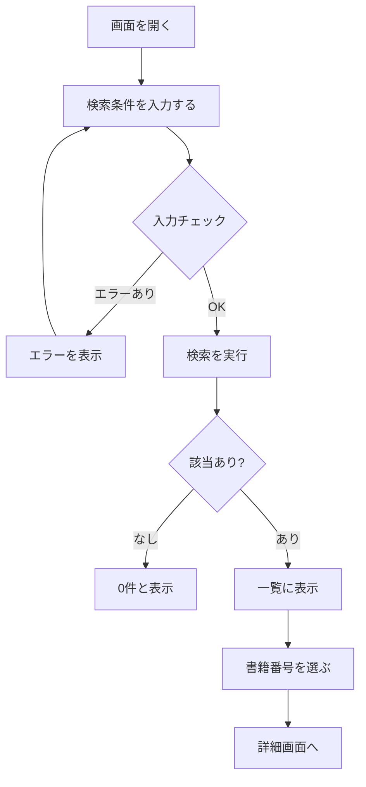

# 【ダミー】DEMO-001 図書検索（サンプル）設計書 — 調整版

> **これはダミーです。** 「GitHub Pages で Markdown の設計書がどう見えるか」を確認するための架空の画面（図書検索）の設計書で、実在するプロジェクトの内容は含んでいません。横に長い表（19 列）と、Mermaid で書いた処理の流れが、どう表示されるかを見るためのものです。

## 画面の概要

| 項目 | 内容 |
|---|---|
| 画面ID | DEMO-001 |
| 画面名 | 図書検索（サンプル） |
| 種類 | 検索・一覧 |
| 利用者 | 図書室の担当者（架空） |

### 使い方の例

| 番号 | 例 | 内容 |
|---|---|---|
| 1 | 本を探す | 書籍番号・タイトル・著者で検索して、一覧に表示する |
| 2 | 本の詳細を見る | 一覧の書籍番号から詳細画面へ移動する |

### 処理の流れ（Mermaid で記述）

## 画面項目の一覧（横に長い表の例）

| ブロック | 番号 | 表示名 | 入出力 | 並び順 | 部品種別 | データ型 | 最小桁 | 最大桁 | 複数行 | 必須 | 初期表示 | 参照テーブル | 参照カラム | DBテーブル | DBカラム | 入力方法 | 部品ID | メモ |
|---|---|---|---|---|---|---|---|---|---|---|---|---|---|---|---|---|---|---|
| 見出し | 1 | 画面タイトル | 出力 | 1 | ラベル | 文字 |  | 30 | - | - | 図書検索（サンプル） | - | - | - | - | 固定表示 | P-LBL-01 | ダミー |
| 検索条件 | 2 | 書籍番号 | 入力 | 2 | テキスト | 半角英数 | 1 | 10 | - | ○ |  | 書籍 | 書籍番号 | T_BOOK | BOOK_NO | テキスト入力 | P-TXT-01 | 前方一致 |
| 検索条件 | 3 | タイトル | 入力 | 3 | テキスト | 全角 | 0 | 80 | - |  |  | 書籍 | タイトル | T_BOOK | TITLE | テキスト入力 | P-TXT-01 | 部分一致 |
| 検索条件 | 4 | 著者 | 入力 | 4 | テキスト | 全角 | 0 | 40 | - |  |  | 著者 | 著者名 | T_AUTHOR | AUTHOR_NAME | テキスト入力 | P-TXT-01 |  |
| 検索条件 | 5 | 分類 | 入力 | 5 | 選択 | コード | - | - | - |  | すべて | 分類 | 分類コード | T_CATEGORY | CATEGORY_CD | プルダウン | P-SEL-02 | コード一覧から |
| 検索条件 | 6 | 出版年（から） | 入力 | 6 | 日付 | 年 | 4 | 4 | - |  |  | 書籍 | 出版年 | T_BOOK | PUB_YEAR | 年入力 | P-YR-01 |  |
| 検索条件 | 7 | 出版年（まで） | 入力 | 7 | 日付 | 年 | 4 | 4 | - |  |  | 書籍 | 出版年 | T_BOOK | PUB_YEAR | 年入力 | P-YR-01 | から≦まで |
| 検索条件 | 8 | 貸出可能のみ | 入力 | 8 | チェック | 真偽 | - | - | - |  | オフ | - | - | - | - | チェックボックス | P-CHK-01 |  |
| 操作 | 9 | 検索 | 入力 | 9 | ボタン | - | - | - | - |  |  | - | - | - | - | ボタン | P-BTN-01 | Enterでも実行 |
| 操作 | 10 | 条件クリア | 入力 | 10 | ボタン | - | - | - | - |  |  | - | - | - | - | ボタン | P-BTN-01 |  |
| 結果一覧 | 11 | 行番号 | 出力 | 11 | テキスト | 数値 | 1 | 4 | ○ |  |  | - | - | - | - | 連番 | P-GRD-01 |  |
| 結果一覧 | 12 | 書籍番号 | 出力 | 12 | リンク | 半角英数 | 1 | 10 | ○ |  |  | 書籍 | 書籍番号 | T_BOOK | BOOK_NO | リンク | P-GRD-01 | 詳細へ |
| 結果一覧 | 13 | タイトル | 出力 | 13 | テキスト | 全角 | 0 | 80 | ○ |  |  | 書籍 | タイトル | T_BOOK | TITLE | テキスト | P-GRD-01 |  |
| 結果一覧 | 14 | 著者 | 出力 | 14 | テキスト | 全角 | 0 | 40 | ○ |  |  | 著者 | 著者名 | T_AUTHOR | AUTHOR_NAME | テキスト | P-GRD-01 |  |
| 結果一覧 | 15 | 出版社 | 出力 | 15 | テキスト | 全角 | 0 | 40 | ○ |  |  | 出版社 | 出版社名 | T_PUBLISHER | PUB_NAME | テキスト | P-GRD-01 |  |
| 結果一覧 | 16 | 出版年 | 出力 | 16 | テキスト | 年 | 4 | 4 | ○ |  |  | 書籍 | 出版年 | T_BOOK | PUB_YEAR | 年 | P-GRD-01 |  |
| 結果一覧 | 17 | 分類 | 出力 | 17 | テキスト | コード | 1 | 3 | ○ |  |  | 分類 | 分類名 | T_CATEGORY | CATEGORY_NAME | テキスト | P-GRD-01 | コード→名称 |
| 結果一覧 | 18 | 所蔵数 | 出力 | 18 | テキスト | 数値 | 0 | 3 | ○ |  | 0 | 蔵書 | 所蔵数 | T_STOCK | STOCK_QTY | 数値 | P-GRD-01 | 右寄せ |
| 結果一覧 | 19 | 貸出中 | 出力 | 19 | テキスト | 数値 | 0 | 3 | ○ |  | 0 | 貸出 | 貸出数 | T_LOAN | LOAN_QTY | 数値 | P-GRD-01 | 右寄せ |
| 結果一覧 | 20 | 状態 | 出力 | 20 | アイコン | コード | 1 | 1 | ○ |  |  | 蔵書 | 状態 | T_STOCK | STATUS | アイコン | P-ICO-01 | 可／不可 |
| 結果一覧 | 21 | 最終更新 | 出力 | 21 | テキスト | 日時 | 14 | 14 | ○ |  |  | 書籍 | 更新日時 | T_BOOK | UPDATED_AT | 日時 | P-GRD-01 |  |
| 下部 | 22 | 件数 | 出力 | 22 | テキスト | 数値 | 0 | 6 | - |  | 0 | - | - | - | - | テキスト | P-PGR-01 | 検索結果の件数 |
| 下部 | 23 | ページ切替 | 入力 | 23 | ページャ | - | - | - | - |  | 1 | - | - | - | - | ページャ | P-PGR-01 | 20件ごと |
| 下部 | 24 | メニューへ戻る | 入力 | 24 | ボタン | - | - | - | - |  |  | - | - | - | - | ボタン | P-BTN-01 |  |

### ボタンなどの動き

| 番号 | きっかけ | 対象 | 動き | 呼び出す処理 | 移動先 | メモ |
|---|---|---|---|---|---|---|
| 1 | クリック | 検索 | 入力チェックのあと検索する | DEMO-SEARCH | - | Enter でも実行 |
| 2 | クリック | 条件クリア | 検索条件を初期表示に戻す | - | - | - |
| 3 | クリック | 結果一覧の書籍番号 | 詳細画面へ移動する | - | DEMO-002 | 同じタブ |
| 4 | 変更 | ページ切替 | 指定ページを再検索する | DEMO-SEARCH | - | 20 件ごと |

## 確認したいこと（例）

| 番号 | 種類 | 内容 | 仮の方針 | 回答 | 状態 |
|---|---|---|---|---|---|
| 1 | 業務 | 出版年の初期値は空でよいか | 空 | - | 未回答 |
| 2 | 方式 | 1 ページの件数 | 20 件 | - | 未回答 |

## 更新の記録

| 版 | 日付 | 更新者 | 内容 |
|---|---|---|---|
| 1.0 | 2026/11/05 | 作成者 | ダミーとして作成 |
